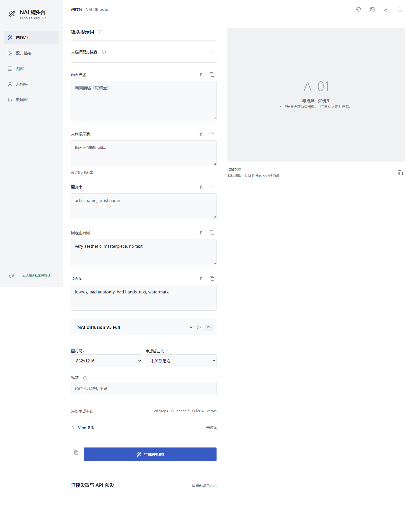
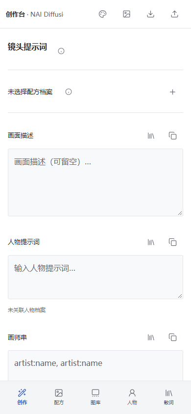

# NAI 镜头台

一个本地优先的 NovelAI 生图与提示词档案工具。

它把画面描述、人物、画师串、正面词、负面词、模型参数与生成图片保存在同一份可检索档案里，适合需要反复试图、整理配方和复用提示词的个人创作者。

> 非 NovelAI 官方项目，与 Anlatan / NovelAI 无隶属或合作关系。



## 使用方式

### 在线使用

[直接打开在线版](https://shuerryyyy.github.io/nai-lens-studio/)，也可以从仓库右侧的 **Deployments** 或 **About** 区域进入。

在线版的数据只保存在当前浏览器中。更换浏览器、清理网站数据或使用无痕模式，都可能导致本地档案丢失；请定期使用工具内的“备份”功能下载 JSON 备份。

### 下载单文件版

[下载 v2.25 单文件版](download/nai-lens-studio-v2.25-standalone.html)

下载后直接用浏览器打开即可。单文件版已经内嵌主程序、ZIP 解析组件和标题字体，适合保存到电脑或发送到手机使用。

## v2.25 配方 Guidance 与资料保护

配方可选保存常用 Guidance；留空时载入配方不会改变创作台当前值。改善图片归档兼容、备份中 Vibe 的关联，以及损坏资料保护和旧数据迁移。手机本地文件连接官方接口失败时会给出排查提示；也可使用上面的在线版。

更新前请先备份。新版会升级本地图片数据库，旧版无法直接打开升级后的数据库；更换浏览器或文件版与在线版之间的数据需要通过备份迁移。无痕浏览结束后本地资料仍可能被清除。

## v2.24 从库取词记忆与作者搜索

创作台“从库选择”会按库分别记住搜索词、排序与滚动位置，关闭后再次打开或刷新页面仍可恢复。配方档案搜索作者名时，会优先只显示该作者的画师串，不再混入其他作者的提示词、备注或关联图片命中；输入部分作者名时同样按作者筛选。

## v2.23 人物替换修复

人物选择弹窗会将当前使用的人物勾选并锁定，不计入本次选择。另选人物后，“替换为已选人物”仅保留新选人物；“追加已选人物”保留原人物并加入新选择。没有新选人物时两个按钮均禁用。

## v2.22 文件夹排序与接口适配检查

配方档案文件夹可通过标题旁的六点手柄拖动排序，支持鼠标、触控及键盘，顺序随备份保留。接口适配增加不联网的“本地检查适配”，完善导入、参数校验与错误反馈，并修复若干存储、备份和 Vibe 状态问题。代码已按职责整理，原有界面及数据格式保留。

这是个人自用工具，维护时间与精力有限，问题修复和功能请求可能无法及时处理。接口适配文件决定各服务商的参数与返回格式如何对应；先核对地址、密钥、额度和模型，再检查适配映射，最后核对返回原图及服务商文档。成功出图或本地检查通过不代表全部参数生效；Fox 横竖尺寸问题尚未确认原因。详见 [适配文件说明](adapters/README.md)。更新前请备份档案，并单独导出适配文件。

## v2.21 复用后默认随机种子

从图库、配方、画师串、散词或人物库取用内容时，种子自动清空；输入框下以小灰字显示“原始种子：…”，仅供参考。升级时也会清除旧设置里意外保留的固定种子。需要固定生成时，可手动填写种子；留空则每次随机，填写 `0` 也是固定种子。

## v2.20 服装词条、时间查看与人物备份更新

散词库新增“服装”类型；创作台人物提示词下方新增可选服装栏，可手填或从库取用，留空也能生成。服装随图片归档、复用和备份保留。图片、配方和词条点击信息圆标可查看生成或首次保存时间。

恢复备份时，能确认是同一人物且备份修改时间较新，会更新人物资料（包括明确清空的字段），保留本地编号与原有图片关联。旧备份不会覆盖本地较新版本；时间相同或缺失时保留本地。更新前请先下载 JSON 备份。

## v2.19 可导入接口适配

在“连接设置与 API 预设”中展开“接口适配文件”，可复制给 AI 的完整说明、下载格式规范和示例、导入/导出 JSON 并绑定 API 预设。请将服务商公开文档与说明一起交给 AI，缺少文档时不能靠猜测证明兼容。

首版仅支持单次 POST JSON 文生图，暂不支持排队、流式、签名、Vibe 和自动重试。文件格式检查通过不代表服务商采用全部参数，需从返回原图核对；适配配置不在档案备份中，换设备请单独导出。原有连接可继续选择“自动识别 / 默认格式”。完整格式和示例见 [适配文件说明](adapters/README.md)。

## v2.18 接口修复说明

旧版在 YesNAI 的 `/v1/images/generations` 路径中，扩展参数位置与站点协议不匹配，可能导致自定义负面词和部分参数未被采用。v2.18 已修复并经用户生成的原始 PNG 核对。Aurora 的 Seed 类型已按公开文档适配，尚未实测生成；其他站点不能仅凭成功出图认定参数全部生效。已有图片和档案不会被改写，可在详情查看原图保留的记录。

## 主要功能

- 支持 NAI Diffusion V5 Full、V5 Curated、V4.5、V4 与 V3（实际支持以服务商为准）。
- 分开编辑和复制画面描述、人物提示词、服装、画师串、正面词与负面词。
- 以“配方档案”保存画师风格、适用模型、常用参数、作者备注、来源和对应作品。
- 四个资料库支持文件夹展开、收起、改名及内容移动；删除文件夹不会删除其中资料，文件夹随对应资料库一起备份。
- 创作台取词支持排序，人物勾选不会因搜索或排序丢失；画面描述可留空，直接测试画师串。
- 人物库支持结构化外貌字段及多人同时选用；当前多人选用是合并提示词，不是独立角色坐标控制。
- 散词库支持画面描述、服装、画师串、正面词、负面词和整套配方，可记录作者并按作者搜索。
- 可按来源链接或其片段查找配方、关联图片、人物和散词。
- 散词库以列表浏览为主，通过加号打开新增或编辑面板；手机全屏编辑。
- 取用画师串同步生成归入，切换配方保留画面描述标签。
- 图片按所用词条的作者检索；旧图片仅在词串能可靠匹配时补充检索。
- 配方与散词支持多选，可为所选条目统一填写或清除作者备注，搜索时保留选择。
- 图库可组合人物、图片标签、配方、模型和收藏条件筛选，并支持批量收藏、追加标签、移动和删除。
- 图库采用直角纯图片陈列，支持删除标签而不删除图片；提示词和参数在图片详情中查看。
- Vibe 支持参考图上传、多选叠加、逐项强度与信息提取量、编码缓存、素材收藏/标签和命名组合；可导入 `.naiv4vibe`、`.naiv4vibeBundle` 与镜头台 Vibe JSON，导出为镜头台 JSON。
- 导入 PNG、WebP 或 JPEG，读取其中仍然保留的文本、EXIF 或受支持的 alpha 隐写生成信息；自动拆词后请核对结果。
- 下载保留元数据的原图，或重新编码为不携带 PNG 提示词文本块的 JPG 分享版。
- 图片详情分别显示档案填写的负面词与原图记录的负面词及参数；缺少元数据时明确说明无法核实。
- JSON 备份可自由选择图库、配方、人物、散词和 Vibe 库，并与全部日期或日期范围组合；恢复时与本机数据合并并预览去重结果。

Vibe 目前用于 V3、V4.5 等兼容模型，V5 下暂停发送并保留选择。上传图片只保存在本地；生成需要新编码时会先提示费用，已编码数据会缓存。第三方原生 NovelAI 路径使用官方请求格式；通用兼容路径需确认支持参考数组，编码新图片还需填写编码接口。未对真实付费接口作端到端验证；请先使用低成本参数核对服务商兼容性。Vibe JSON 导出可能包含参考原图，分享前请确认内容。

生成中可停止等待，三分钟后自动结束等待；服务端仍可能继续处理或扣费，请先检查记录再重试。第三方接口是否接受噪声调度与透明背景参数取决于服务商。Seed 无法从图片核实时显示为请求值，不保证服务商实际采用。更新前请下载 JSON 备份；网页版和单文件版的数据不会自动互通。
- 手机端文件夹原地展开；图库筛选结果固定显示在筛选区下方。
- 桌面与手机响应式界面，包含四套本地外观主题。



## 第一次使用

1. 打开“连接设置与 API 预设”。
2. 选择 NovelAI 官方直连或你信任的兼容站点。
3. 填写自己的 Token / API Key。不要使用他人分享的未知凭据。
4. 先点击“套用低成本测试参数”，生成一张小图确认连接。
5. 创建配方、人物或散词后，再开始长期归档。
6. 有重要数据后立即下载一次完整备份。

## 数据与隐私

- 项目没有自己的服务器、账号系统或云端图库。
- 图片、配方、文件夹和 Vibe 保存在浏览器 IndexedDB 中；人物、散词与界面设置使用浏览器本地存储，均不自动同步到云端。
- Token 默认只保留在当前页面会话；只有用户主动选择“记住”时才写入浏览器本地存储。
- JSON 备份不包含 Token、接口预设或外观设置。
- 生图请求会发送到用户自己填写或选择的服务地址；请只使用可信服务商。

详细说明见 [PRIVACY.md](PRIVACY.md)。如果报告安全问题，请先阅读 [SECURITY.md](SECURITY.md)。

## 已知限制

- 浏览器前端不能绕过服务端 CORS。官方直连出现 `Failed to fetch` 时，通常需要改用明确允许浏览器请求的可信接口。
- 第三方站点是否支持 V5、请求参数和返回格式，由该站点决定。
- PNG 经截图或社区平台压缩后，提示词元数据可能已经丢失。
- JPG 分享版会产生有损压缩，透明区域会变成白色；它不代替原图归档。
- 尚未使用真实 Token 完成扣费型端到端测试，首次使用请从低成本参数开始。

## 本地运行与开发

直接打开 `index.html` 可以使用大多数功能。若浏览器限制本地文件能力，可在仓库目录启动任意静态文件服务器后访问。

公开版结构：

```text
index.html                         在线版入口
assets/nai-studio.js               共享界面、状态与档案控制
assets/nai-storage.js              数据库与存储事务
assets/nai-generation.js           生图请求与流程
assets/nai-image-metadata.js       图片元数据读取
assets/nai-image-import.js         图片导入归档
assets/nai-backup.js               备份与恢复
assets/nai-vibes.js                Vibe 控制
assets/nai-boot.js                 最后执行的启动入口
assets/nai-base.css                基础样式
assets/nai-adapters.js             声明式接口适配与设置
adapters/                         适配规范与示例
assets/nai-features.js             文件夹、取词排序与筛选
assets/flat-ui.css                 用户确认的无卡片视觉系统
assets/flat-controls.js            SVG 工具与按需说明
assets/jszip.min.js                ZIP 解析依赖
assets/nai-title.ttf               标题字体子集
download/nai-lens-studio-*.html    可独立运行的单文件版
screenshots/                       项目预览图
licenses/                          第三方许可证
```

## 反馈与贡献

欢迎通过 GitHub Issues 报告问题或提出建议。请不要在截图、日志或 Issue 中粘贴 Token、API Key、私人反代地址或包含隐私的提示词与图片。

提交修改前请阅读 [CONTRIBUTING.md](CONTRIBUTING.md)。版本变化见 [CHANGELOG.md](CHANGELOG.md)。

## 许可证与商标

项目自有代码使用 [MIT License](LICENSE)。JSZip、Lucide SVG 与保留的 Noto Serif SC 字体子集分别保留各自许可证，详见 [THIRD_PARTY_NOTICES.md](THIRD_PARTY_NOTICES.md)。

“NovelAI”是其权利人的商标。本项目名称仅用于说明兼容用途，不代表官方认可、赞助或合作。
